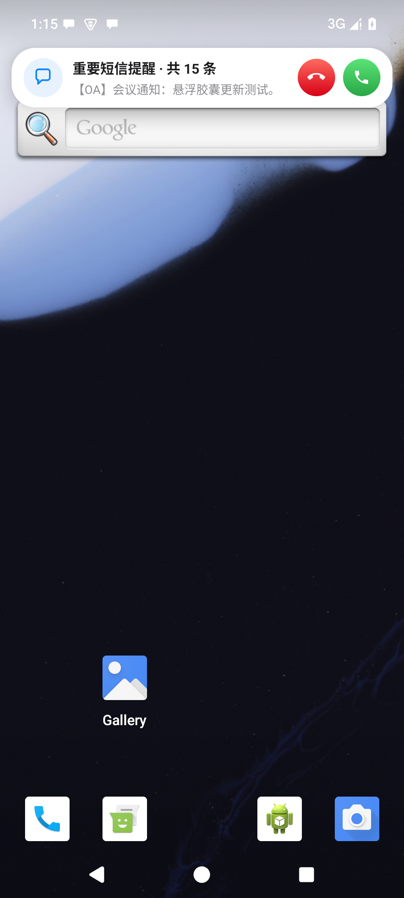
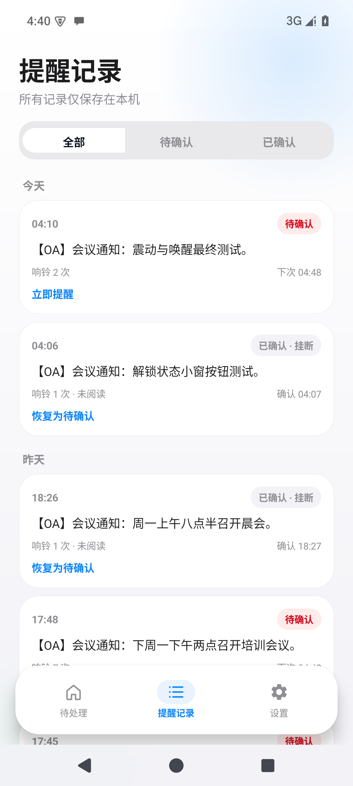

# 重要短信哨兵 · SMS Sentinel

> 只监听一个指定号码，把含关键词的会议短信变成「来电式」全屏提醒，确保重要通知不被错过。

<p align="center">
  
  &nbsp;&nbsp;
  
  &nbsp;&nbsp;
  
</p>

---

## ✨ 核心功能

| 功能 | 说明 |
|---|---|
| 📞 来电式全屏提醒 | 锁屏时全屏弹出，接听 = 已阅，挂断 = 未阅 |
| 🫧 系统级悬浮胶囊 | 解锁状态下在任意 App 顶部弹出常驻来电胶囊 |
| 🔁 循环提醒 | 未确认时每隔 5/10/15/30/60 分钟再次响起 |
| 🔑 关键词过滤 | 默认只提醒含「会议/开会/参会/议程/会场」的短信 |
| 🔕 静音仍震动 | 震动由 App 直接驱动，不受系统静音/勿扰拦截 |
| 📋 提醒记录 | 按今天/昨天/日期分组，支持恢复待确认 |
| 🛡️ 厂商保活指引 | 小米 HyperOS、OPPO、vivo、荣耀 自启动设置路径 |
| 🔒 纯本地 | SharedPreferences + JSON，无网络、无账号、无第三方分析 |

---

## 📱 截图

<p align="center">
  
  
  
  
</p>

---

## 🚀 快速开始

### 环境要求

- JDK 17
- Android SDK Platform 35（Android 15）
- Build-Tools 35.0.0

### 构建

```bash
cd android-app
./gradlew assembleDebug
```

> Gradle 下载慢？`gradle/wrapper/gradle-wrapper.properties` 已配置腾讯云镜像；依赖仓库优先使用阿里云镜像。

### 安装

```bash
adb install -r android-app/重要短信哨兵-v1.4.1-debug.apk
```

或直接把 APK 发到手机安装（需允许"安装未知来源应用"）。

---

## ⚙️ 首次配置

1. 打开 App → **适配与权限**，依次授予：
   - ✅ 短信接收权限（必要）
   - ✅ 通知权限（必要）
   - ✅ 全屏来电提醒（Android 14+ 需系统设置单独授权）
   - ✅ 悬浮来电横幅（显示在其他应用上层）
   - ☑️ 精确定时（可选，缺失时提醒可能延迟）
2. 点击 **厂商保活设置**，按机型打开自启动、后台运行、无限制省电。
3. **设置 → 短信过滤** 确认关键词（默认 `会议,开会,参会,议程,会场`）。
4. 点击 **模拟一次来电** 验证铃声、震动、接听/挂断。

---

## 📁 代码结构

```text
android-app/app/src/main/java/com/smssentinel/app/
├── SentinelApp.kt              # 通知渠道初始化
├── MainActivity.kt             # 底部导航 + 短信详情
├── IncomingCallActivity.kt     # 来电式全屏提醒
├── PermissionActivity.kt       # 权限诊断与引导
├── data/                       # 数据层（Task / TaskStore / SettingsStore）
├── sms/                        # 短信接收与解析
├── reminder/                   # 循环提醒调度（AlarmManager）
├── service/                    # 前台监听服务（保活）
├── notification/               # 通知构建（CallStyle / 高优先级）
├── ui/                         # 界面（Home / Records / Settings）
└── util/                       # 权限检查 / 厂商保活指引 / 时间格式化
```

---

## 📦 版本历史

| 版本 | 日期 | 更新内容 |
|---|---|---|
| **v1.4.1** | 2026-10-20 | 有悬浮窗权限时通知改为低优先静默，只弹系统级悬浮胶囊 |
| **v1.4.0** | 2026-10-20 | 新增 SYSTEM_ALERT_WINDOW 全局悬浮来电胶囊 |
| **v1.3.3** | 2026-10-20 | 解锁状态使用 CallStyle 来电通知常驻置顶 |
| **v1.3** | 2026-10-20 | iOS 27 视觉打磨：渐变背景、玻璃卡、脉冲环、分组记录 |
| **v1.2** | 2026-10-20 | 震动走 USAGE_ALARM 不受静音拦截；锁屏唤醒测试 |
| **v1.1** | 2026-10-20 | 前台监听服务保活；应用内顶部来电横幅；会议关键词过滤 |
| **v1.0** | 2026-10-20 | 初版：指定号码监听、来电式全屏提醒、循环提醒 |

---

## ⚠️ 已知限制

- **Google Play 上架**：`RECEIVE_SMS` 权限受严格审查，非默认短信应用可能无法上架，当前定位为个人/内部侧载。
- **厂商冻结**：前台监听服务能降低被冻结概率，但无法完全绕过小米/OPPO/vivo 省电策略，需手动完成厂商保活设置。
- **精确定时**：Android 12+ 需用户授权 `SCHEDULE_EXACT_ALARM`，缺失时提醒可能延迟。

---

## 🔗 相关仓库

| 仓库 | 内容 |
|---|---|
| [zmxy-](https://github.com/yckl/zmxy-) | 造梦西游全套游戏素材 |
| [MuMu-](https://github.com/yckl/MuMu-) | MuMu 模拟器去广告工具 |
