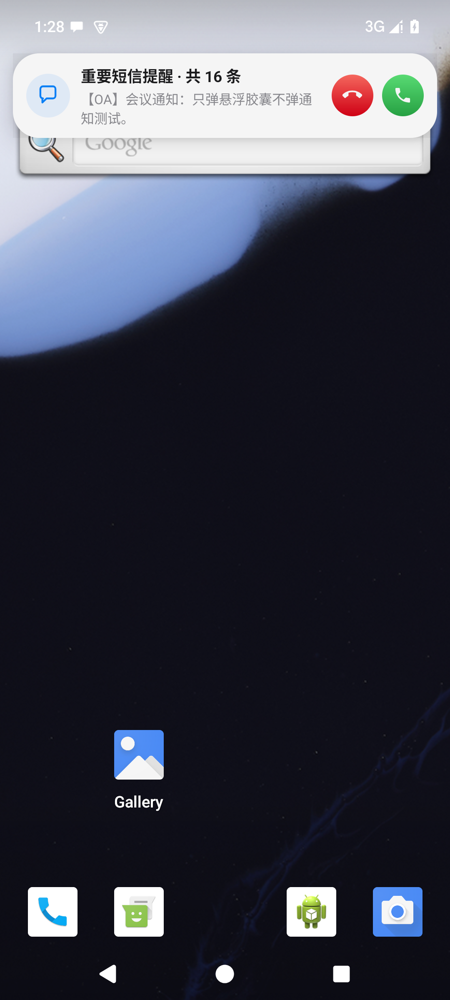
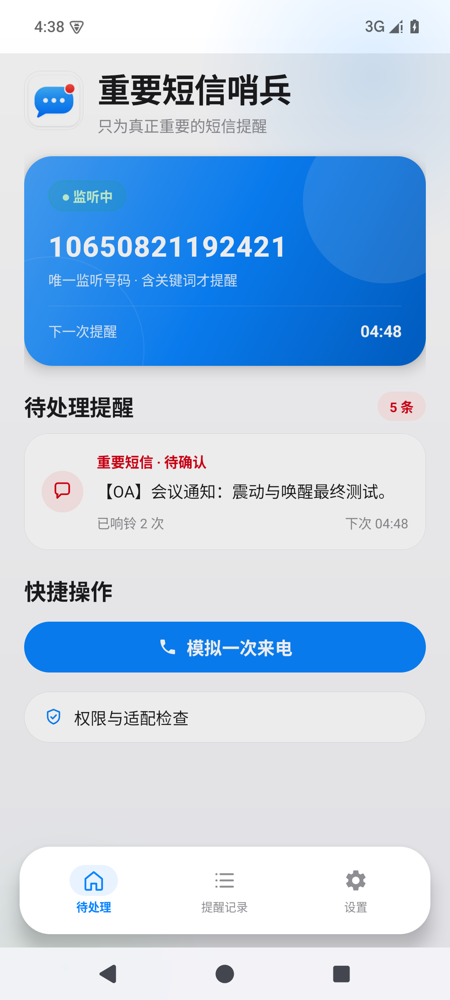
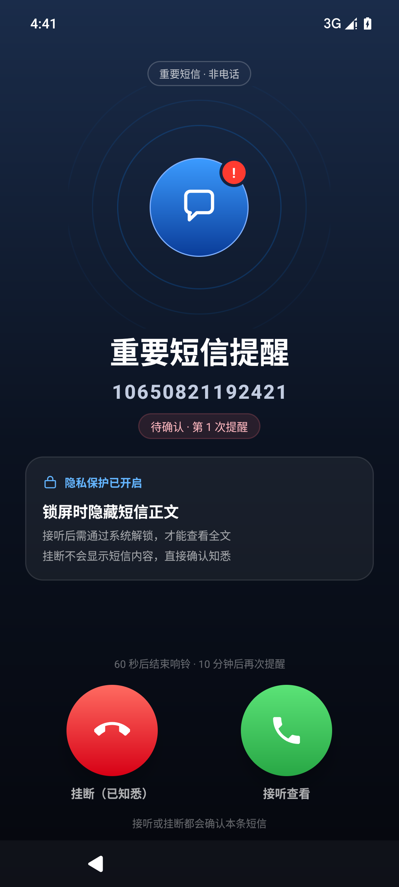
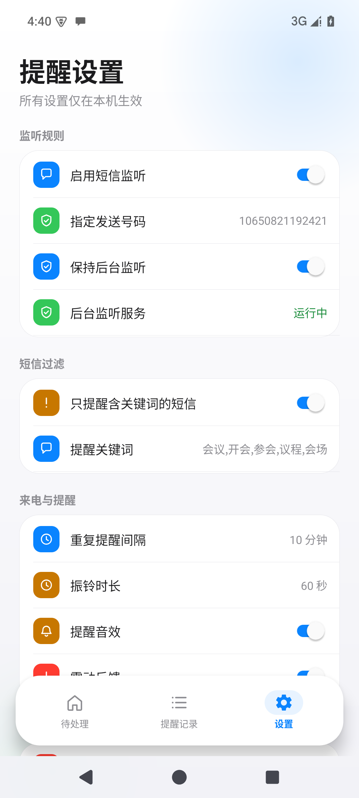

<div align="center">

# 重要短信哨兵

**SMS Sentinel · Android**

把指定号码的会议短信变成「来电式」全屏提醒，确认前循环响起，绝不错过。

[](https://developer.android.com)
[-3DDC84)](https://developer.android.com)
[](https://kotlinlang.org)
[](https://github.com/yckl/sms-sentinel/releases)

</div>

---

## 截图

<p align="center">
  
  
  
  
</p>

---

## 功能

- **来电式全屏提醒** — 锁屏时全屏弹出，接听 = 已阅，挂断 = 未阅，返回/划掉不确认
- **系统级悬浮胶囊** — 解锁状态下，无论在哪个 App，顶部弹出常驻来电胶囊
- **循环提醒** — 未确认时每隔 5/10/15/30/60 分钟再次响起，直到明确操作
- **关键词过滤** — 只提醒含「会议/开会/参会/议程/会场」的短信，其余静默
- **静音仍震动** — 震动直接驱动 Vibrator，不受系统静音/勿扰拦截
- **前台保活服务** — 降低厂商回收进程的概率，重启后自动恢复调度
- **厂商保活指引** — 内置小米 HyperOS、OPPO、vivo、荣耀的自启动设置路径
- **纯本地** — SharedPreferences + JSON，无网络、无账号、无第三方分析

---

## 构建

**环境要求：** JDK 17 · Android SDK Platform 35 · Build-Tools 35.0.0

```bash
cd android-app
./gradlew assembleDebug
```

> Gradle 下载慢？`gradle-wrapper.properties` 已配置腾讯云镜像；依赖仓库优先使用阿里云镜像。

---

## 首次配置

1. **适配与权限** 页依次授予：短信接收、通知、全屏来电提醒、悬浮窗、精确定时
2. **厂商保活设置** — 打开自启动、后台运行无限制、锁屏通知
3. **设置 → 短信过滤** — 确认或自定义关键词
4. 点击「**模拟一次来电**」验证铃声、震动、接听/挂断是否正常

---

## 代码结构

```
android-app/app/src/main/java/com/smssentinel/app/
├── data/           # Task 模型、TaskStore、SettingsStore
├── sms/            # SmsReceiver、MessageAssembler、NumberMatcher
├── reminder/       # AlarmManager 调度、循环提醒、开机恢复、铃声控制
├── service/        # MonitoringService 前台保活
├── notification/   # CallStyle / 高优先级通知构建
├── ui/             # HomeFragment、RecordsFragment、SettingsFragment
└── util/           # 权限检查、厂商保活指引、时间格式化
```

---

## 版本历史

| 版本 | 更新内容 |
|---|---|
| **v1.4.1** | 有悬浮窗权限时通知改为静默，只弹系统级悬浮胶囊 |
| **v1.4.0** | 新增 `SYSTEM_ALERT_WINDOW` 全局悬浮来电胶囊 |
| **v1.3.3** | 解锁状态使用 CallStyle 常驻来电通知 |
| **v1.3** | iOS 27 视觉打磨：渐变背景、玻璃卡、脉冲环、分组记录 |
| **v1.2** | 震动走 `USAGE_ALARM` 不受静音拦截；锁屏唤醒测试 |
| **v1.1** | 前台保活服务；应用内顶部来电横幅；会议关键词过滤 |
| **v1.0** | 初版：指定号码监听、来电式全屏提醒、循环提醒 |

---

## 已知限制

- **Google Play 上架**：`RECEIVE_SMS` 受严格审查，当前定位为个人/内部侧载
- **厂商冻结**：前台服务可降低被冻结概率，但必须手动完成厂商保活设置
- **精确定时**：Android 12+ 需授权 `SCHEDULE_EXACT_ALARM`，缺失时提醒可能延迟

---

<div align="center">
  <sub>版权所有 © 2026 yckl · 仅供个人使用</sub>
</div>
